# PySQA Web

**Sound quality analysis in your browser, with no programming needed.**

PySQA Web is the web version of [PySQA](https://github.com/henriquealende/PySQA) (Python Sound Quality Analyser). You give it sound recordings (WAV files, or a microphone) and it shows you what they look like and how they are *perceived*: how loud, how sharp, how rough, how tonal. It also helps you measure how a structure vibrates and prepare listening-test sounds.

You do not need to write code, install audio tools or know signal processing. Open the page, drop a file, click a metric.

> The pictures below were taken with two synthetic test sounds (an engine-like hum with harmonics and a fan-like noise) and a simulated vibrating structure, so you can see the screens without any personal data.

---

## What is it for?

| If you want to... | Use this module |
|---|---|
| Record a sound with your microphone, check its level in dB SPL and send it to analysis | **Data Acquisition** |
| See a sound as a waveform, spectrum or spectrogram, and compute loudness, sharpness, roughness, tonality... | **Post-Processing** |
| Find the resonances (natural frequencies) of a structure from a hammer or shaker test | **System Analysis** |
| Place a sound in a room, around a head and on headphones to prepare a listening test | **Audio Preparation** |
| Learn what each control and metric means, with worked examples | **Documentation** (button at the top right of the app) |

The four modules sit in the bar at the top of the page. The **PT / EN** buttons switch the language of the whole interface.

---

## A typical session in 60 seconds

1. Open **Post-Processing** and drop one or more `.wav` files on the box at the top left.
2. Click a file in the list: you see its waveform (top) and spectrum (bottom).
3. Switch the view (Spectrogram, 1/3 Octave, Envelope) with the buttons above the plot.
4. Pick a metric in the **Metric** menu (for example *Loudness ISO 532-1*). A progress bar shows the calculation.
5. Open **Batch** to compute several metrics for several files at once and export the table to Excel.

If something goes wrong, every page has a **Report a bug** button at the bottom of the left column.

---

## The modules

### Post-Processing

The main workbench. Load WAV files, look at them in four ways, compute psychoacoustic metrics, clean the sound with filters and compare files.

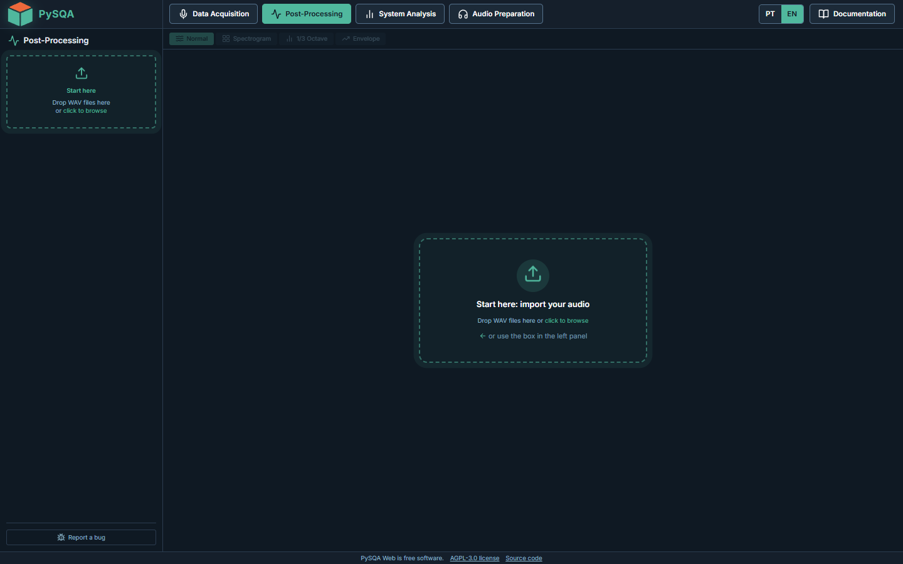

**Normal view: waveform and spectrum.** The top plot is the pressure over time; the bottom plot is how the energy is spread over frequency (log scale, in dBFS, or in dB SPL once the microphone is calibrated). Drag on the waveform to select a section and analyse only that part.

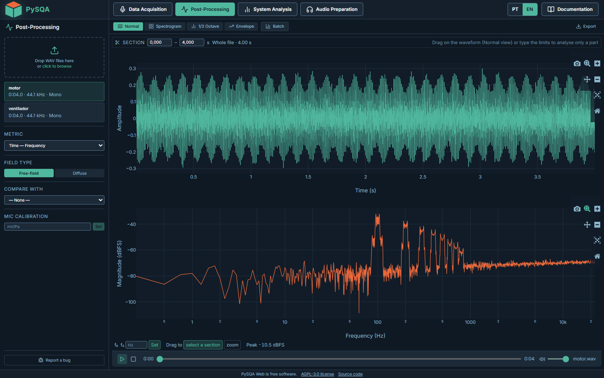

**Other views.** Each one has a small gear icon for its settings.

| View | What it shows | Good for |
|---|---|---|
| **Spectrogram** | Frequency (vertical) against time (horizontal), colour = level | Seeing how a sound changes: engine run-up, whistles, clicks |
| **1/3 Octave** | Level in 31 standard bands, with optional A-weighting | Comparing with standards, noise reports |
| **Envelope** | The slow "outline" of the signal's amplitude | Beating, modulation, impulsive events |

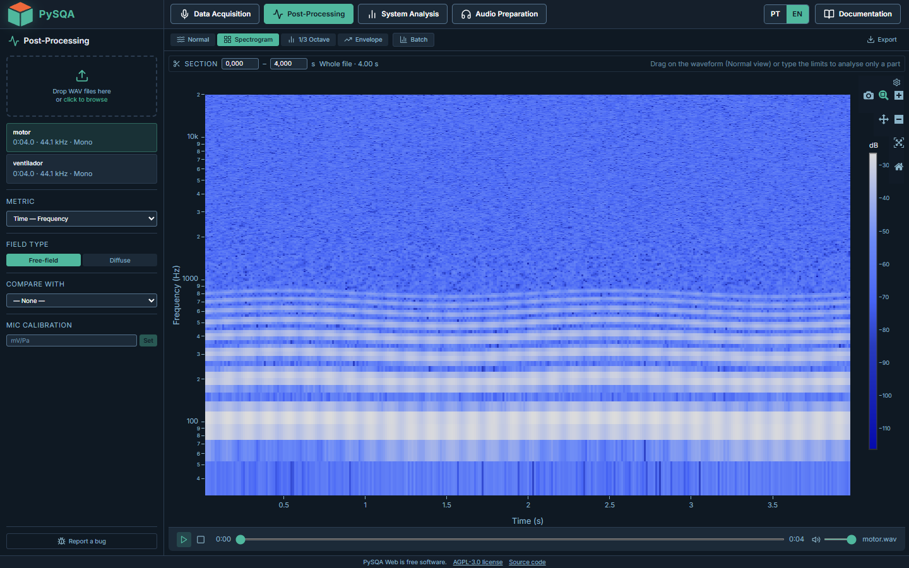

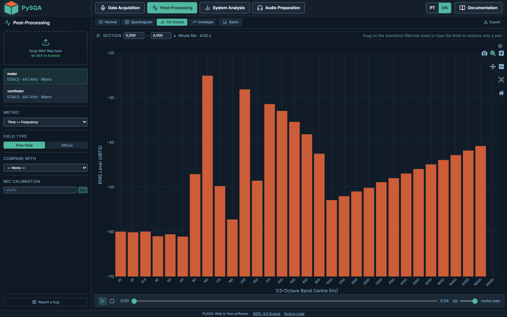

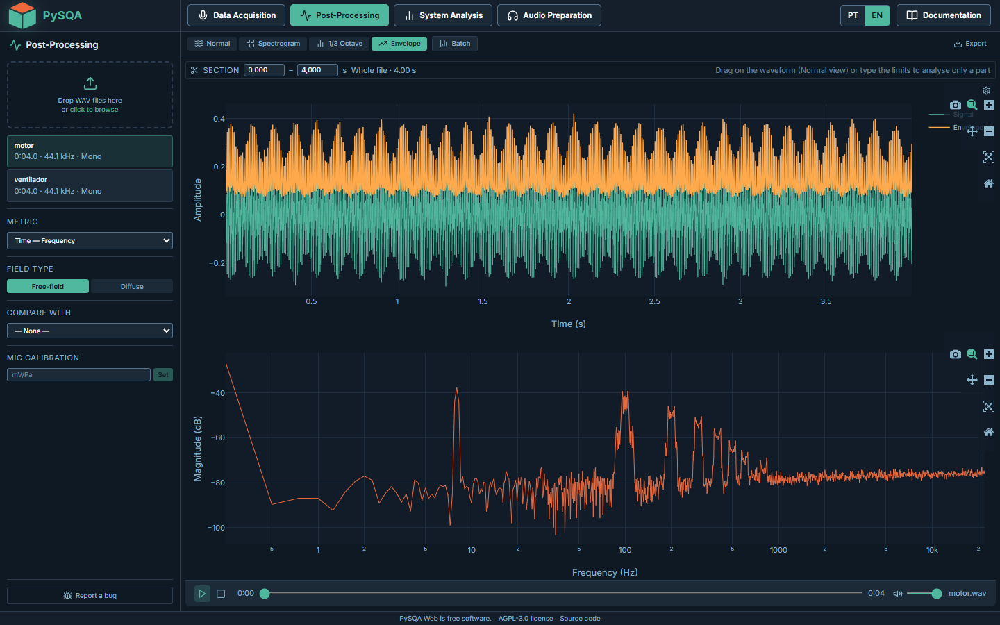

**Psychoacoustic metrics.** These numbers try to describe what a person hears rather than what a microphone measures. Choose one in the **Metric** menu; the plot shows how it evolves over time (top) and how it is spread over frequency (bottom), with the global value above the plot.

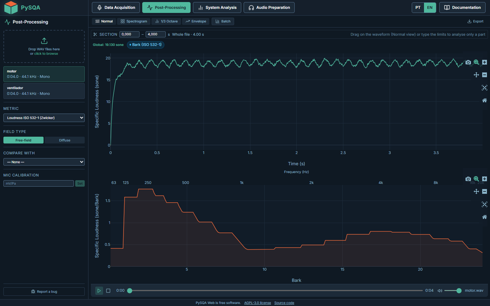

| Metric | In plain words | Unit |
|---|---|---|
| Loudness (ISO 532-1 Zwicker, ECMA-418-2) | How loud it sounds | sone |
| Sharpness (DIN 45692) | How "shrill" or bright it sounds | acum |
| Roughness (Daniel & Weber, ECMA-418-2) | The harsh, rattling feeling of fast modulation | asper |
| Fluctuation Strength | The slow wobble of modulation | vacil |
| Tonality (ECMA-418-2) | How much a pure tone stands out of the noise | tu |
| IPM (Impulse Prominence Metric) | How much impulsive events (clicks, bangs) stand out | dB |

Two options matter for these numbers: **Field type** (*Free-field* or *Diffuse*) tells the loudness, sharpness and tonality models how the sound reached the listener, and **Mic calibration** (mV/Pa) turns the file from relative units into real pascals so levels read in dB SPL. Annoyance indices (SIL and Zwicker-Fastl) combine several metrics into one number in the Batch panel.

**Processing.** The *Processing* button on a file opens a window with four tabs: *Filtering* (band-pass, low-pass, high-pass, band-reject, 1/3-octave equaliser, harmonic notch), *Windowing*, *Weighting* (A or C) and *Loudness adjustment* (scale a sound to a target loudness). The result is a new file in the list; the original is never changed.

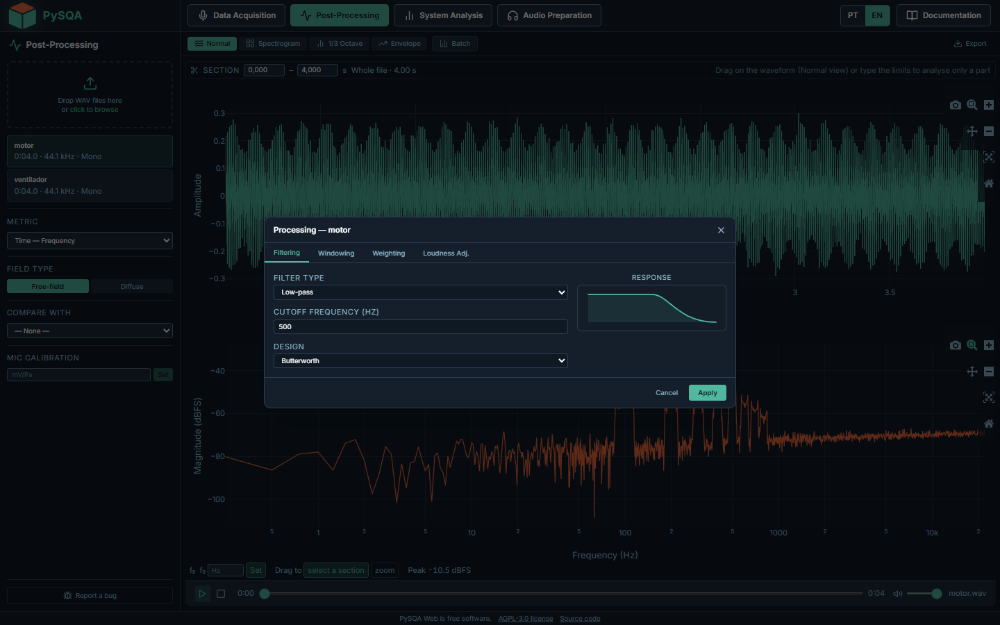

**Batch.** Tick the files and the metrics, press **Compute**, and get one table you can export to Excel (XLSX).

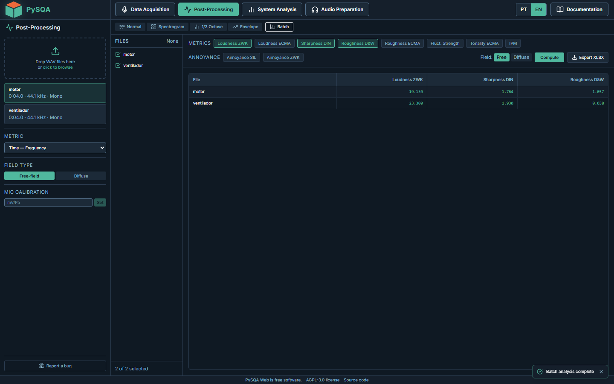

Other things you can do here: play a file, compare it with another, analyse only a section, export the processed sound as WAV or the data as XLSX / CSV.

---

### Data Acquisition

Record straight from a microphone connected to your computer. Nothing is uploaded until you choose to send the recording to Post-Processing.

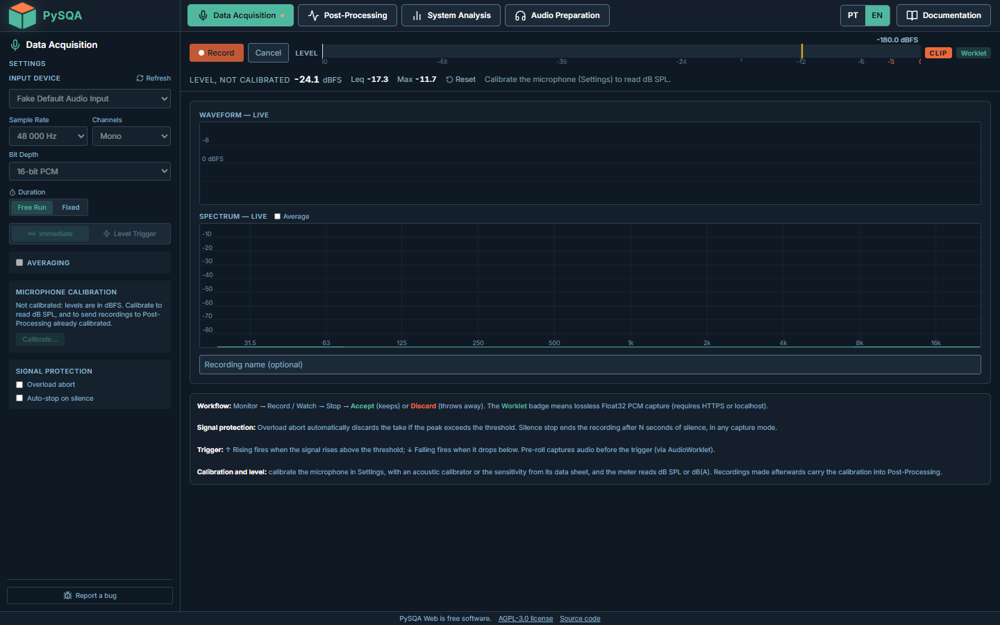

- Pick the **input device**, **sample rate**, **channels** and **bit depth** on the left.
- Press **Monitor** to see the live waveform, the live spectrum and a level meter (current level, Leq, Max, with a CLIP warning). Nothing is recorded yet.
- Press **Record**, then **Stop**, then **Accept** (keep it) or **Discard**.
- Capture modes: free run, **fixed duration** (exact to the sample), **level trigger** (starts when the sound rises above a threshold, and keeps a short pre-roll), plus optional **overload abort** and **auto-stop on silence**.
- **Calibrate...** starts a wizard: use an acoustic calibrator or type the sensitivity from the microphone data sheet. After that the meter reads **dB SPL** (or dB(A)) and the recording carries its calibration into Post-Processing.

The browser asks for permission to use the microphone. Lossless capture needs HTTPS or `localhost`. (The screenshot above used a fake test microphone.)

---

### System Analysis

Measures how a structure (a plate, a car door, a machine frame) responds to a force and finds its resonances. This is the **Frequency Response Function (FRF)**.

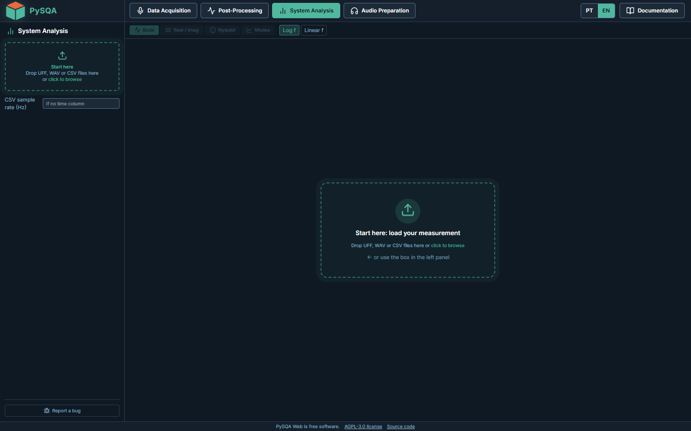

1. Load the measurement: **UFF/UNV**, **WAV** or **CSV** files (a CSV without a time column asks for the sample rate).
2. In the **Channels** table mark one channel as **Input** (the force, from the hammer or shaker) and one or more as **Output** (what responds, e.g. an accelerometer).
3. Choose the **estimator**: **H1** (best when the noise is on the response), **H2** (noise on the force) or **Hv** (noise on both), and the averaging: *Welch* for noise or sweep excitation, *Impact* for hammer tests (it finds each hit and averages them).
4. Read the plots: **Bode** (magnitude, phase and *coherence*, which tells how much you can trust each frequency), **Real / Imag**, **Nyquist** and **Modes**.

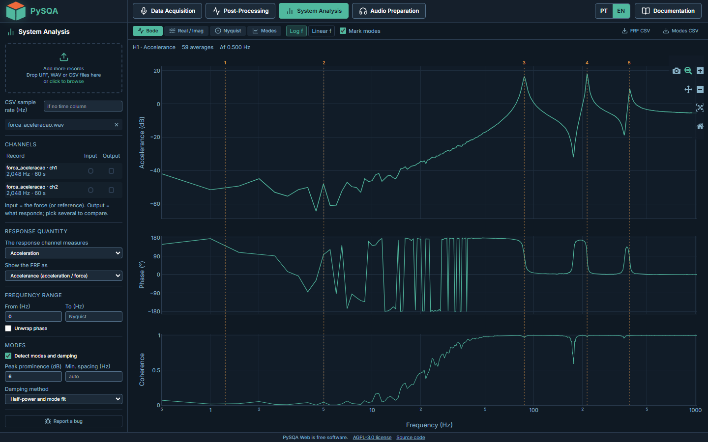

Turn on **Detect modes and damping** to list each resonance with its frequency, damping ratio, Q, bandwidth and coherence, together with plain-language warnings (for example "coherence is low here, the estimate is noisy"). Export the FRF or the modes table as CSV.

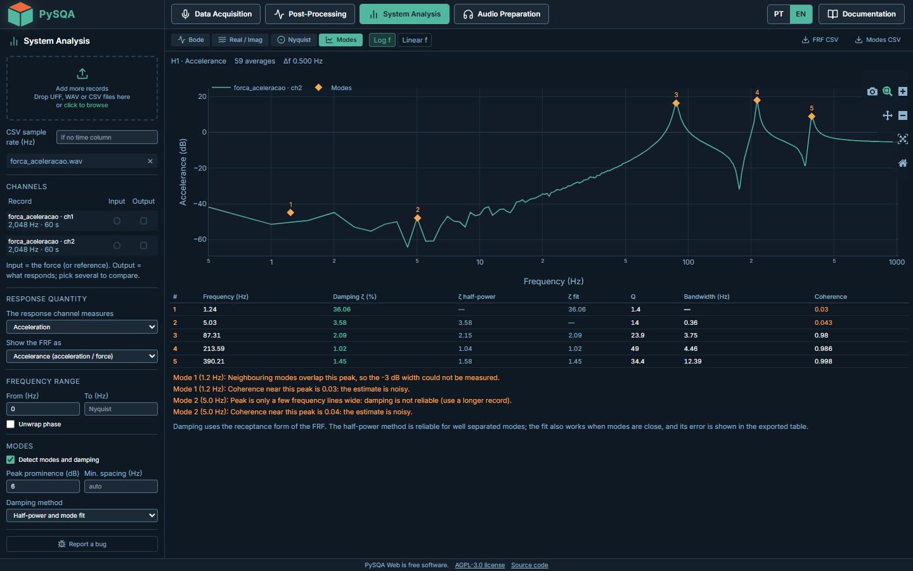

The example is a simulated system with three known resonances (about 87, 214 and 390 Hz). Peaks at very low frequency, where coherence is near zero, are flagged as unreliable by the app itself.

---

### Audio Preparation

Prepares a **stimulus for a listening test**: take a dry sound and make it sound as if it were in a room, heard by a person, on a given pair of headphones. The result is a stereo file you can analyse in Post-Processing.

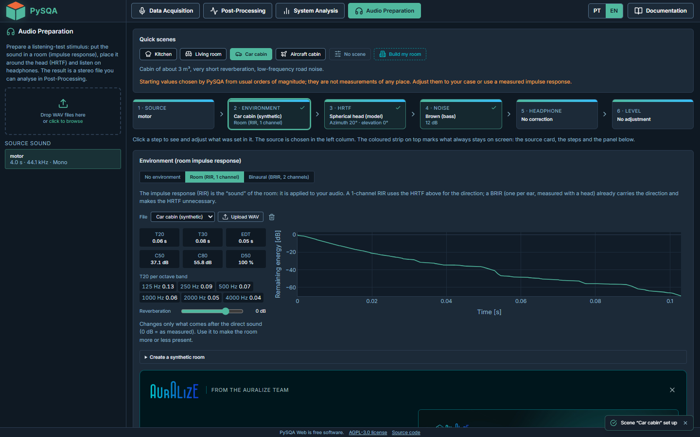

The work is a chain of six steps, shown as cards at the top:

1. **Source**: the sound you uploaded.
2. **Environment**: a room impulse response (the "sound" of the room). Use a ready scene, build a synthetic room, or upload a measured response (1 channel or binaural). The panel shows reverberation times (T20, T30, EDT) and clarity (C50, C80, D50).
3. **HRTF**: the direction the sound comes from, using a head model (azimuth and elevation).
4. **Noise**: background noise to add, at a chosen level.
5. **Headphone**: a correction curve for the headphones, from a built-in library or your own CSV.
6. **Level**: the final listening level.

**Quick scenes** (Kitchen, Living room, Car cabin, Aircraft cabin) set the whole chain in one click with typical starting values. They are *orders of magnitude, not measurements of a real place*, so adjust them or use a measured response. An **A/B player** lets you compare before and after.

---

### Documentation

A full help section inside the app, in Portuguese and English, with the theory, guided examples and the references behind every module. Open it with the **Documentation** button at the top right.

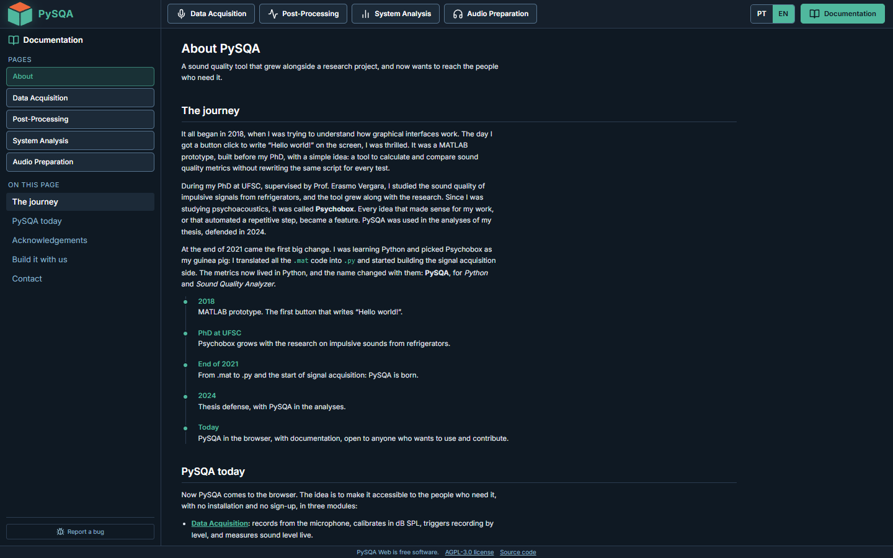

---

## Glossary

| Term | Meaning |
|---|---|
| **WAV** | An uncompressed audio file; the format this app reads |
| **dBFS** | Level relative to the largest value the file can hold. Always negative; without calibration this is all the app can say |
| **dB SPL** | Real sound pressure level (re 20 µPa). Needs a calibrated microphone |
| **dB(A)** | A level weighted to follow human hearing; the usual choice for noise |
| **Leq** | The average level over the measurement (equivalent continuous level) |
| **Spectrum** | How the energy is spread over frequency |
| **Spectrogram** | A spectrum that evolves with time |
| **1/3 octave** | A standard way of grouping frequencies into bands |
| **Sone, acum, asper, vacil, tu** | Units of the psychoacoustic metrics (see the table above) |
| **Free-field / Diffuse** | Sound arriving from one direction / from all around |
| **FRF** | Frequency Response Function: how strongly a structure responds at each frequency |
| **Coherence** | From 0 to 1: how reliable an FRF value is (near 1 is good) |
| **Mode** | A natural vibration pattern of a structure, with its own frequency and damping |
| **RIR / BRIR** | Room impulse response / the same measured at each ear of a head |
| **HRTF** | How the head and ears change a sound depending on its direction |

---

## Running it on your computer

PySQA Web can run locally so your files never leave your machine. The easy way is the two start scripts below; you only need Python and Node.js installed once.


## Requirements

| Tool | Minimum version |
|------|----------------|
| Python | 3.10 |
| Node.js | 18 |
| npm | 9 |

> On Windows, running scripts requires PowerShell execution policy to allow local scripts:
> ```powershell
> Set-ExecutionPolicy -Scope CurrentUser -ExecutionPolicy RemoteSigned
> ```

---

## Quick Start

Open **two terminals** in the project root folder (`PySQA web/`).

### Terminal 1 -- Backend (FastAPI)

**Windows (PowerShell):**
```powershell
.\start_backend.ps1
```

**Linux / macOS:**
```bash
./start_backend.sh
```

What the script does on first run:
1. Creates a Python virtual environment in `backend/.venv`
2. Installs all dependencies from `backend/requirements.txt`
3. Starts the FastAPI server on **http://localhost:8000**

Interactive API docs available at **http://localhost:8000/docs**

---

### Terminal 2 -- Frontend (Vite + React)

**Windows (PowerShell):**
```powershell
.\start_frontend.ps1
```

**Linux / macOS:**
```bash
./start_frontend.sh
```

What the script does on first run:
1. Runs `npm install --legacy-peer-deps` to install all Node dependencies
2. Starts the Vite dev server on **http://localhost:5173**

The frontend proxies all `/api` requests to `http://localhost:8000`.

---

## Manual Setup (without scripts)

### Backend
```bash
cd backend
python -m venv .venv

# Windows
.venv\Scripts\activate
# Linux / macOS
source .venv/bin/activate

pip install -r requirements.txt
uvicorn main:app --reload --port 8000
```

### Frontend
```bash
cd frontend
npm install --legacy-peer-deps
npm run dev
```

---

## ECMA-418-2 metrics (`sottek-hearing-model`)

Loudness, Roughness and Tonality ECMA-418-2 use the `sottek-hearing-model` package, which is pinned in
`backend/requirements.txt` and installed with the other dependencies. If the import fails in some environment,
those three metrics are disabled and all other features keep working.

Tonality runs on `backend/psychoacoustics/ecma_fast/tonality_exact.py`, a reorganised copy of the package's function
(AGPL-3.0, see License) that gives the same results (to about 1e-6) with about a sixth of the memory and a third of the time; if it fails
for an unexpected reason, the package's own function answers instead. The same file has an approximate `shm_tonality_ecma_fast`
(about twice as fast again; global tonality within 0.2%, tonal frequency within about 1 Hz), chosen with the "Tonality precision"
selector (Exact is the default; the API takes `precision: "exact" | "fast"`).
`dev-tests/bench_ecma.py` (`tonality`, `roughness`) records a
reference from the package and compares any candidate with it (time, peak memory, relative difference).

---

## Hosted deployment: resource limits

On a small container (the project runs on the Render Standard plan, 2 GiB and 1 CPU; it used to run on Starter, 512 MiB) the server protects itself instead of
running out of memory. The limits switch on automatically when a memory limit is detected (the
container's cgroup limit, `PYSQA_MEMORY_MB`, or the `RENDER` variable) and stay off on a local
machine. `GET /api/health` reports the limits in force.

| Variable | Hosted default (512 MiB; ×4 on 2 GiB) | Meaning |
|----------|--------------------------|---------|
| `PYSQA_MEMORY_MB` | detected | Memory budget of the process |
| `PYSQA_MAX_UPLOAD_MB` | 30 | Largest upload |
| `PYSQA_MAX_AUDIO_SECONDS` | 60 | Longest file |
| `PYSQA_MAX_FILES_PER_SESSION` | 20 | Uploads plus processed copies in one session |
| `PYSQA_MAX_AUDIO_RAM_MB` | 120 | float64 audio held in RAM across all sessions |
| `PYSQA_SESSION_IDLE_MIN` | 30 | Minutes without activity before a session is dropped |
| `PYSQA_HEAVY_WAIT_S` | 120 | How long a heavy calculation waits for its turn |
| `PYSQA_MAX_EXPORT_CELLS` | 100000 | Largest Excel table the server builds (CSV is made in the browser) |
| `PYSQA_TMP_DIR` | `backend/tmp_sessions` | Where session files are kept |

`PYSQA_MAX_COMPUTE_S` (75) is the longest one calculation may be expected to take: the slow analyses (Tonality, Loudness and Roughness
ECMA, Loudness ISO, Roughness D&W, Fluctuation) have a measured time model and are refused, with the length that does fit, when it
would hold the only compute slot for longer. `/api/health` also reports `peak_rss_mb`, the highest memory since the server started.

Set a limit to `0` to disable it alone; larger containers get proportionally larger defaults.
Only one heavy calculation runs at a time, and a calculation whose estimated memory does not fit is
refused up front with a message instead of crashing the process. Measured on a 512 MiB container:
Loudness ISO 532-1 and Sharpness accept about 4-5 s of audio, Loudness ECMA-418-2 about 1.7 s, and
Roughness / Tonality ECMA-418-2 do not fit at all (they need roughly 440 and 540 MB per second of audio).
On the 2 GiB Standard plan the caps are four times larger (120 MB upload, 240 s, 80 files, 480 MB of audio, 400000 cells)
and, estimated from the same cost table, Loudness ISO 532-1 and Sharpness accept about 30 s, Loudness ECMA-418-2 about 10 s,
and Roughness / Tonality ECMA-418-2 about 2.5-3 s.

On Linux the server also tunes the memory allocator when the limits are on: it answers each request in
its own thread, and without this the memory freed by one calculation stayed in that thread's arena, so the
free memory shrank after every heavy calculation (a 512 MiB container ended up refusing a 3 s section).
`GET /api/health` shows `allocator_tuned`; setting `MALLOC_ARENA_MAX` or `MALLOC_MMAP_THRESHOLD_` yourself
leaves it alone.

A longer file can still be analysed in pieces: select a section (drag on the waveform in the Normal view, or
type the limits in the Section bar). Every analysis (spectrum, spectrogram, 1/3-octave, envelope, metrics,
batch) then runs on that part only, and the memory check is made on the length of the section. The API takes
the same `t0` / `t1` (seconds) on the view endpoints and in the body of `/metrics`, and `sections`
(`audio_id` -> `[t0, t1]`) in the body of `/batch`.

---

## Bug reports

Every page has a **Report a bug** button at the bottom of the left column. The report (text, optional contact, page, open file, view and browser; never the audio) is appended to `backend/feedback/reports.jsonl` and, when configured, forwarded so it reaches you even though the hosted disk is temporary:

| Variable | Effect |
|---|---|
| `PYSQA_FEEDBACK_WEBHOOK` | URL of a Slack / Discord incoming webhook; each report is posted there |
| `PYSQA_FEEDBACK_EMAIL_TO` | e-mail that receives each report; needs `PYSQA_SMTP_HOST` (and `PYSQA_SMTP_PORT`, `PYSQA_SMTP_USER`, `PYSQA_SMTP_PASSWORD`, `PYSQA_SMTP_FROM`) |
| `PYSQA_FEEDBACK_TOKEN` | secret that opens `GET /api/feedback` (header `X-Feedback-Token`), which lists the reports kept on the server |
| `PYSQA_FEEDBACK_DIR` | folder of the JSON-lines file (default `backend/feedback`) |

A sender can file 5 reports per 10 minutes.

## Session recovery

The server keeps uploaded files in memory and on a temporary disk, so a restart, a deploy or an
out-of-memory kill wipes every session. To make that invisible, the browser keeps what is needed to
rebuild its session in its own IndexedDB: a copy of each uploaded WAV and the processing steps applied
to it (nothing is sent anywhere else). The browser also chooses the id of every file it uploads or
creates, so a restored file comes back under the same id and nothing on screen changes.

- After a page reload the file list, selection and microphone calibrations come back.
- When the server answers 404 for a file it forgot, the missing files are re-uploaded and the processing
  steps replayed (parents first), then the request is repeated; a banner shows the progress.
- A request that stays pending while `/api/health` does not answer shows a "server is not responding" banner.
- Copies of sessions untouched for 7 days are deleted; **Clear & re-upload** forgets the current session's copy.
- Recordings made in Data Acquisition are copied the same way once they are sent to Post-Processing.

---

## Project Structure

```
PySQA web/
+-- backend/
|   +-- main.py                  # FastAPI entry point; also serves frontend/dist
|   +-- requirements.txt
|   +-- routers/
|   |   +-- audio.py             # Upload, visualisation, psychoacoustic metrics
|   |   +-- processing.py        # Filter, window, weighting, loudness adj.
|   |   +-- export.py            # WAV / XLSX / CSV download
|   |   +-- frf.py               # System Analysis (FRF) endpoints
|   +-- services/
|   |   +-- session_store.py     # In-memory session management
|   |   +-- audio_service.py     # Signal processing & metrics logic
|   |   +-- frf_service.py       # FRF estimators, coherence, modes, damping, UFF/WAV/CSV readers
|   +-- psychoacoustics/         # Psychoacoustic metric implementations
|   +-- processing/              # DSP helpers (filtering, windowing)
|   +-- utils/                   # lang (PT/EN server messages), limits (memory guard), samples
|
+-- frontend/
|   +-- public/                  # Logo and the recorder AudioWorklet
|   +-- src/
|       +-- pages/PostProcessing/    # Post-Processing and Batch
|       +-- pages/SystemAnalysis/    # FRF page and plots
|       +-- pages/DataAcquisition/   # Recording, calibration wizard, SPL meter
|       +-- pages/Docs/              # Documentation pages (PT/EN) and demo data
|       +-- components/              # Plot panel, processing modal, layout, shared UI
|       +-- i18n/                    # PT (default) / EN dictionaries in locales/<lang>/
|       +-- store/                   # Zustand stores
|       +-- api/                     # Typed fetch wrappers, session recovery, caches
|       +-- types/index.ts
|
+-- dev-tests/                   # Development checks (see its README); archive/ holds one-off scripts
+-- render.yaml                  # Render deployment (single web service)
+-- PROJECT_MAP.md               # Map of the repository and cleanup notes
+-- start_backend.ps1 / start_backend.sh
+-- start_frontend.ps1 / start_frontend.sh
+-- README.md
```

---

## Feature checklist

| Feature | Status |
|---------|--------|
| WAV upload (drag-and-drop or click) | Done |
| File list with metadata | Done |
| Waveform + Spectrum | Done |
| Spectrogram (STFT heatmap) | Done |
| 1/3-Octave bands (Z / A weighting) | Done |
| Signal envelope | Done |
| Loudness ISO 532-1 Zwicker | Done |
| Sharpness DIN 45692 | Done |
| Roughness Daniel & Weber | Done |
| Fluctuation Strength D&W | Done |
| IPM (Impulse Prominence Metric) | Done |
| Loudness ECMA-418-2 | Done (requires sottek_hearing_model) |
| Roughness ECMA-418-2 | Done (requires sottek_hearing_model) |
| Tonality ECMA-418-2 | Done (requires sottek_hearing_model) |
| Filters (HP / LP / BP / Notch) | Done |
| Time windowing | Done |
| Analyse only a section of a file (drag on the waveform or type the limits) | Done |
| Loudness adjustment | Done |
| Microphone calibration (mV/Pa) | Done |
| Field type selector (free / diffuse) | Done |
| Batch analysis | Done |
| Annoyance indices (SIL, Zwicker-Fastl) | Done |
| Export WAV / XLSX / CSV | Done |
| Audio playback (Web Audio API) | Done |
| Lossless WAV playback and download (the upload is kept as sent; processed files are 32-bit float) | Done |
| Data Acquisition: microphone calibration wizard (acoustic calibrator or typed sensitivity), carried into Post-Processing | Done |
| Data Acquisition: live sound level meter (dB SPL or dB(A), Leq, Max, Peak) | Done |
| Data Acquisition: exact fixed duration, silence stop and level trigger (counted in samples inside the AudioWorklet) | Done |

---

## Deployment

Hosted on Render (`render.yaml`): one web service, Standard plan (2 GiB, 1 CPU). The build installs the backend,
builds the frontend and FastAPI serves it; `/api/health` is the health check and `main` deploys automatically.
The disk is ephemeral, so the browser keeps a copy of the uploaded files and restores them after a restart.

## License

PySQA Web is free software, distributed under the terms of the **GNU Affero General Public License v3.0**
(AGPL-3.0, see [LICENSE](LICENSE)). It includes code derived from the
[Sottek Hearing Model](https://github.com/acoustics-code-salford/sottek-hearing-model) (AGPL-3.0-only,
M. J. B. Lotinga, University of Salford): `backend/psychoacoustics/ecma_fast/` is a modified version of its
tonality function. If you run a modified version as a network service, the AGPL requires you to offer its
source code to the users of that service.

Third-party components keep their own licenses: MoSQITo (Apache-2.0), NumPy, SciPy, soundfile, h5py and
Bottleneck (BSD), FastAPI, openpyxl and pyuff (MIT), tqdm (MPL-2.0 and MIT). The headphone library is built
from the SBAF measurements (CC BY 4.0).
